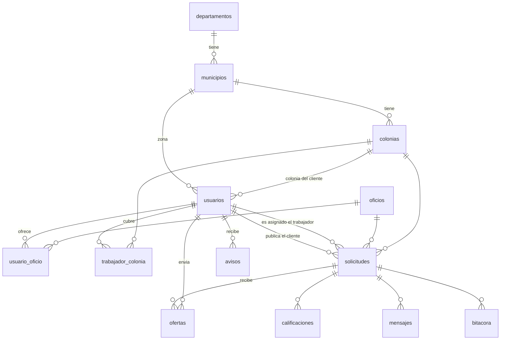
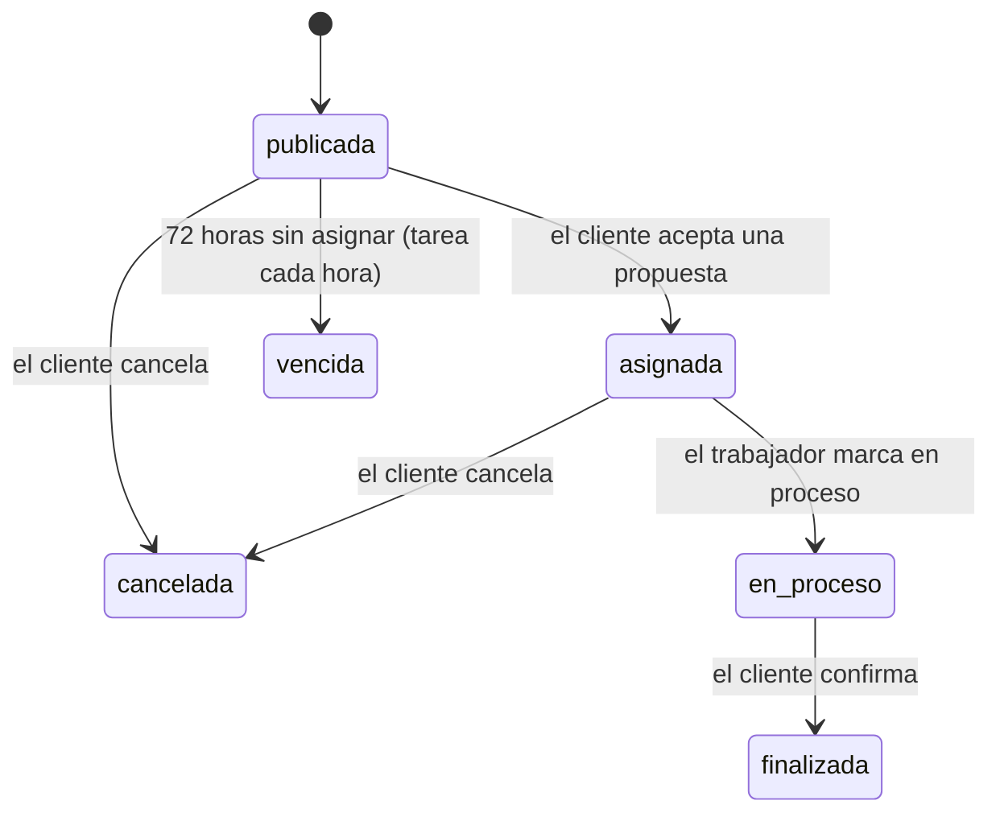

# Plan del proyecto

Resumen operativo de [CLAUDE.md](../CLAUDE.md): qué se usa, cómo encaja y en qué orden se construye.
Si algo difiere, manda CLAUDE.md y esto se actualiza.

## Herramientas

| Capa | Herramienta | Estado |
|---|---|---|
| Base de datos | PostgreSQL 16, `psql`, `pg_dump` | Por instalar (ver README) |
| API | SDK de .NET 10.0.401, proyecto `net10.0` | SDK instalado |
| API | Npgsql, BCrypt.Net-Next, Microsoft.AspNetCore.Authentication.JwtBearer, Swashbuckle.AspNetCore (solo desarrollo) | Última versión estable compatible con `net10.0` al crear el proyecto |
| Android | Android Studio, AGP 9.4.1, Java 11, `compileSdk` 37, `minSdk` 30 | Esqueleto compila (`assembleDebug`) |
| Control de versiones | Git 2.56, repositorio local | Remoto por decidir |
| Pruebas | `bd/06_pruebas.sql`, `api/pruebas.http`, `docs/pruebas-android.md` | La primera ya existe |

`minSdk 30` (Android 11) viene de la plantilla. Si algún teléfono del equipo es más viejo, se baja en `android/app/build.gradle.kts`.

## Arquitectura

```
Android (Java, XML)            API ASP.NET Core                    PostgreSQL 16
Activity                       Controllers                         fn_...  funciones de negocio
  └ ClienteApi                   └ Servicios (JWT, hash, fotos)    trg_... triggers (bitácora, avisos, promedio)
      HttpURLConnection   ──►    └ Repositorios (Npgsql)     ──►   vw_... vistas de lectura
      JSON (org.json)  JWT       llaman a las fn_...               tablas con CHECK y llaves foráneas
```

La lógica de negocio importante vive en la base (aceptar propuesta, DUI, promedio, avisos, bitácora). La API
autentica, autoriza por rol y por dueño del recurso, abre la transacción y traduce los errores `GT001`,
`GT002` y `GT003` a 409, 404 y 403.

## Modelo de datos



Cada rol lleva distintos datos, y la base lo exige con `ck_usuarios_por_rol`:

| Rol | Teléfono | Municipio | Colonia | DUI |
|---|---|---|---|---|
| cliente | sí | sí | sí | no |
| trabajador | sí | sí | no (usa `trabajador_colonia`) | sí |
| administrador | no | no | no | no |

## Estados de una solicitud



Cada cambio queda en `bitacora` por trigger. Teléfono y dirección exacta se entregan solo desde `asignada`
y solo a las dos partes.

## Tandas de trabajo

Cada tanda se prueba antes de pasar a la siguiente. Los números de "recorrido" son los de la sección 8 de CLAUDE.md.

| # | Tanda | Incluye | Se comprueba con |
|---|---|---|---|
| 1 | Estructura | Repositorio, `.gitignore`, README, docs, Android en `android/` | Hecha |
| 2 | Base | `01_esquema`, `02_catalogos`, `fn_validar_dui`, `06_pruebas` parcial, `aplicar.ps1` | `.\bd\aplicar.ps1 -Pruebas` en verde (falta instalar PostgreSQL) |
| 3 | Cuentas | `fn_registrar_usuario`, perfil, zona y oficios. API: Auth, Usuarios, Zonas y administrador por semilla. Android: Login, Registro, Perfil | Recorrido 2: registrar cliente y trabajador, DUI inválido rechazado, login por rol |
| 4 | Solicitudes y propuestas | `fn_enviar_oferta`, `fn_aceptar_oferta`, `fn_trabajos_por_zona`, `fn_cancelar_solicitud`. API y Android de ambos roles | Recorrido 3 a 6 y pruebas de `GT001`, `GT002`, `GT003` |
| 5 | Seguimiento | En proceso, finalizar, contacto, calificar con promedio, vencimiento, bitácora | Recorrido 7, 9 y 11 |
| 6 | Mensajes y avisos | Triggers de avisos, `fn_sincronizar`, conversación | Recorrido 8 |
| 7 | Administración | Catálogos, usuarios, suspender, auditoría, reportes | Recorrido 1 y 10 |
| 8 | Cierre | Recorrido completo, `docs/api.md` al día, README, lista de seguridad | Recorrido 1 a 11 |

## Pantallas

El CLAUDE.md define 16 `Activity`. Hay boceto para 8; las demás se diseñan en el mismo estilo (paleta de la sección 7.6) al llegar su tanda.

| Activity | Rol | Boceto |
|---|---|---|
| `LoginActivity` | Sin sesión | `pantalla1_login.png` |
| `RegistroActivity` | Sin sesión | Por diseñar |
| `MisSolicitudesActivity` | Cliente | `pantalla2_mis_solicitudes.png` |
| `NuevaSolicitudActivity` | Cliente | Por diseñar |
| `DetalleSolicitudActivity` | Cliente | Por diseñar |
| `PropuestasActivity` | Cliente | Por diseñar |
| `SeguimientoActivity` | Ambos | Por diseñar |
| `CalificarActivity` | Ambos | Por diseñar |
| `TrabajosZonaActivity` | Trabajador | Por diseñar (tarjetas como las de Mis solicitudes) |
| `DetalleTrabajoActivity` | Trabajador | `pantalla3_detalle_trabajo.png` |
| `MisPropuestasActivity` | Trabajador | `pantalla4_mis_propuestas.png` |
| `MensajesActivity` | Ambos | Por diseñar |
| `ConversacionActivity` | Ambos | `pantalla5_conversacion.png` |
| `PerfilActivity` | Ambos | `pantalla6_perfil_zona.png` (trabajador) |
| `AdminCatalogosActivity` | Administrador | `pantalla7_admin_catalogos.png` (pestaña Oficios; Zonas por diseñar) |
| `AdminUsuariosActivity` | Administrador | `pantalla8_admin_usuarios.png` |

Diferencias entre los bocetos y CLAUDE.md, resueltas así:

- Perfil: el boceto muestra las colonias como casillas y no tiene foto. Se agrega un botón de foto sobre el avatar y un botón "Agregar colonias" que abre el diálogo con búsqueda; las elegidas se muestran como casillas.
- Mis solicitudes: el filtro "En curso" agrupa `asignada` y `en_proceso`. `cancelada` y `vencida` solo salen en "Todas".
- Mis propuestas: la tarjeta aceptada muestra el contacto, así que la pantalla pide `/contacto` por cada propuesta aceptada.
- Catálogos: el conteo "38 trabajadores" obliga a que `GET /admin/oficios` devuelva `trabajadores`.
- Registro: lleva teléfono, que los bocetos no cubren porque no tienen esta pantalla.

## Huecos de CLAUDE.md para decidir en su tanda

- Faltan funciones en la sección 5.3: crear solicitud, rechazar propuesta, retirar propuesta, enviar mensaje, y los cambios de perfil, oficios, colonias, suspender y reactivar. Propuesta: lo que valida reglas de negocio va en una función `fn_...`; lo que solo guarda datos va como SQL parametrizado en el repositorio.
- Si un trabajador cambia de municipio, sus colonias de trabajo anteriores dejan de ser válidas. Propuesta: la función de perfil las borra.
- Una propuesta rechazada por el cliente no se puede reenviar; solo se reactiva la retirada. Propuesta: `GT001`.
- Mensajes después de `finalizada` o `cancelada`. Propuesta: se leen siempre, se envían solo con la solicitud `asignada` o `en_proceso`.
- Suspensión: comprobar el estado en cada petición o solo al iniciar sesión (pendiente en CLAUDE.md sección 11). Propuesta: en cada petición, porque con el token de 24 horas un suspendido seguiría dentro.
- La prueba "aceptar una propuesta pendiente de una solicitud cancelada lanza `GT001`" no ocurre por el flujo normal, porque cancelar rechaza las pendientes. La prueba fuerza el estado con un `UPDATE` directo.
- Si el cliente nunca confirma, el trabajo queda `en_proceso` y no hay calificaciones. Es consecuencia de la decisión "solo el cliente confirma".

## Para actualizar en los documentos del curso (Avance EV2)

- La app Android no usa Retrofit ni Gson (`HttpURLConnection` y `org.json`).
- Paleta nueva (verde azulado y violeta) en lugar de azul y naranja.
- Teléfono obligatorio en el registro.
- Funciones adicionales de la base listadas arriba, cuando se definan.
